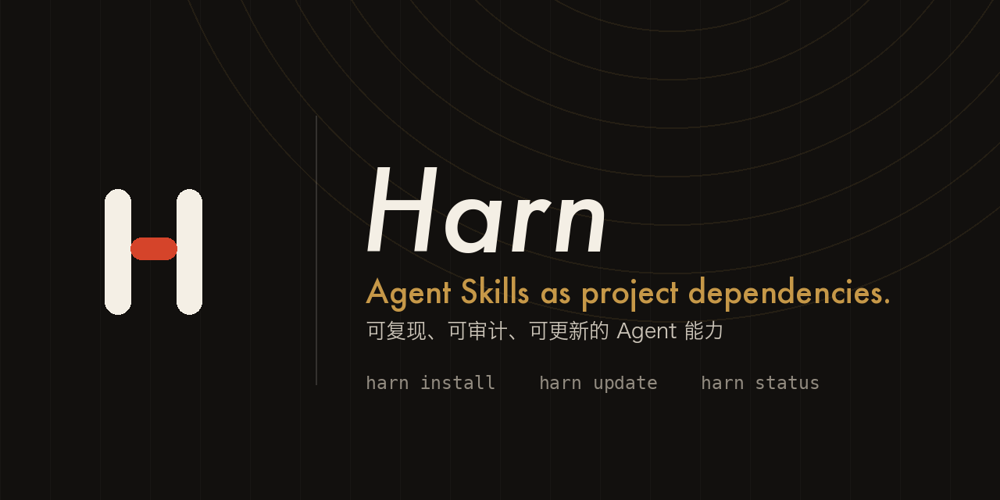
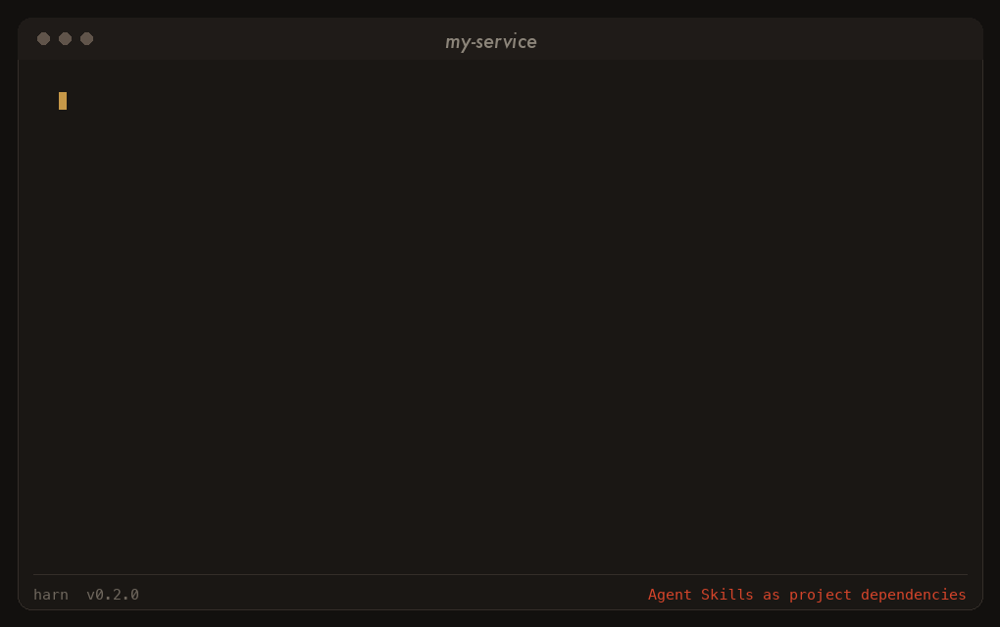

# Harn

[](https://github.com/AwayerCode/Harn/actions/workflows/ci.yml)
[](https://github.com/AwayerCode/Harn/releases/latest)
[](LICENSE)

[English](README.en.md) | 简体中文



Harn 把 Agent Skills 当作可版本化的项目依赖：Skill 源码集中维护，使用仓库时只下载明确选择的资源，并把来源、版本、文件哈希和权限记录在项目自己的 `.harness/downloads.json` 中。

它解决的不是“再安装一个全局工具”，而是让 Agent 能力随项目一起复现、审查和更新。只活在全局目录里的 Skill 无法和它服务的代码一起被审查、复现和升级；业务项目提交 `.harness/downloads.json` 和下载资源后，换机器、换 Agent 或重新打开项目都能从同一份记录继续工作。

## 为什么使用 Harn

- 项目内可复现：资源落在 `.harness/<原路径>`，不依赖某个全局目录。
- 来源可审计：每次下载记录 GitHub 来源、分支/标签/提交、文件哈希和权限。
- 更新有保护：更新前核对所有已记录文件；本地修改、删除、权限变化或路径冲突会让整次更新在写入前失败。
- 发布即二进制：Release 直接提供六种平台产物和 `SHA256SUMS`，不使用压缩包。
- 并发安全：安装和更新持有项目级锁，避免两个进程同时覆盖状态记录。

## 快速开始

一行安装，脚本会校验 `SHA256SUMS` 并把二进制放进 `.harness/bin/harn`：

```bash
curl -fsSL https://raw.githubusercontent.com/AwayerCode/Harn/main/install.sh | sh
```

固定版本或指定项目根目录：

```bash
curl -fsSL https://raw.githubusercontent.com/AwayerCode/Harn/main/install.sh \
  | sh -s -- --version v0.2.0 --root .
```

需要自行审计下载过程时，从 [最新 Release](https://github.com/AwayerCode/Harn/releases/latest) 手动下载：

| 系统 | `amd64` | `arm64` |
| --- | --- | --- |
| macOS | `harn_darwin_amd64` | `harn_darwin_arm64` |
| Linux | `harn_linux_amd64` | `harn_linux_arm64` |
| Windows | `harn_windows_amd64.exe` | `harn_windows_arm64.exe` |

下载 `SHA256SUMS` 后校验文件，再把二进制放到项目的 `.harness/bin/`。逐条命令和 Windows PowerShell 示例见 [HARN.md](HARN.md)。

```bash
.harness/bin/harn search
.harness/bin/harn install \
  --source https://github.com/AwayerCode/Harn \
  --version tag:v0.2.0 \
  --path Skills/concise-response \
  --path Skills/knowledge-doc-guard \
  --path Skills/swe
```

下载后的入口位于 `.harness/Skills/<name>/SKILL.md`。Agent 读取入口后，按该 Skill 自己的规范加载配套资源。



## CLI

`CLI/harn/` 是第一个独立 CLI，使用自己的 Go module；仓库根目录不放置 Go module。后续 CLI 放在 `CLI/<name>/`。

```bash
harn search [query]
harn install --source <url> --version <ref> --path <path> [--path <path>...] [--dry-run]
harn update --path <path> [--path <path>...] | --all [--version <ref>] [--dry-run]
harn list
harn status
harn remove --path <path> [--path <path>...]
harn version
```

`--version` 支持 `branch:<name>`、`tag:<name>` 和 `commit:<sha>`。`--source` 可以是 GitHub 仓库 URL，也可以是直接指向 `.tar.gz` 的 URL；直接归档必须包含所选路径，工具会自动识别有无顶层归档目录。

`--dry-run` 完成解析、下载和校验，但不写文件、不改记录。`status` 逐文件比对内容与权限，发现差异时以非零状态退出，可直接用于 CI。

已安装 Go 时也可以直接用子模块标签安装。Release workflow 会随版本自动创建 `CLI/harn/vX.Y.Z`：

```bash
go install github.com/AwayerCode/Harn/CLI/harn@v0.2.0
```

## 从 Harness 迁移

`harness` 命令已更名为 `harn`，发布资产从 `harness_<os>_<arch>` 改为 `harn_<os>_<arch>`，Go module 路径改为 `github.com/AwayerCode/Harn/CLI/harn`。

项目内的状态目录仍是 `.harness/`，`downloads.json` 结构未变，已有记录无需迁移。更换二进制后直接运行 `harn list` 和 `harn status` 即可确认记录与文件一致。旧的 `harness` 二进制不再更新，切换到 `harn` 后不要再混用两者。

仓库地址从 `AwayerCode/Harness` 改为 `AwayerCode/Harn`。GitHub 会重定向旧的网页地址，但 Go module 路径不会重定向，引用该模块的项目需要更新 import。

## 目录结构

```tree
.
├── Skills/                 # Skill 源码、契约、模板、脚本和测试
├── CLI/
│   └── harn/            # 第一个自有 Go module 和构建脚本
│       ├── internal/       # CLI 内部实现包
│       ├── scripts/        # 发布构建脚本
│       └── dist/           # 本机构建产物，Git 忽略
├── assets/                 # 标志、字标、社交预览和终端演示
├── install.sh              # 校验哈希的一行安装脚本
├── .github/                # CI、Release 和协作模板
├── HARN.md                 # 使用说明
├── AGENTS.md               # 仓库协作约定
└── LICENSE
```

发布二进制由 CI 构建并上传到 GitHub Releases，不提交到源码仓库。`CLI/harn/dist/` 只用于本地验证。

## 开发验证

需要 Go 1.24+、Python 3 和 Bash：

```bash
find CLI/harn -name '*.go' -type f -print0 | xargs -0 gofmt -l
(cd CLI/harn && go test ./...)
(cd CLI/harn && go test -race ./...)
(cd CLI/harn && go vet ./...)
python3 -B Skills/swe/scripts/tests/test_standards.py
python3 -B Skills/knowledge-doc-guard/scripts/knowledge_lint.py --all
```

构建六平台发布产物：

```bash
CLI/harn/scripts/build-release.sh v0.2.0
```

## 贡献与安全

提交前阅读 [CONTRIBUTING.md](CONTRIBUTING.md)。安全问题不要公开提交利用细节，请按 [SECURITY.md](SECURITY.md) 的私密渠道报告。

## 许可证

本项目使用 [MIT License](LICENSE)。
